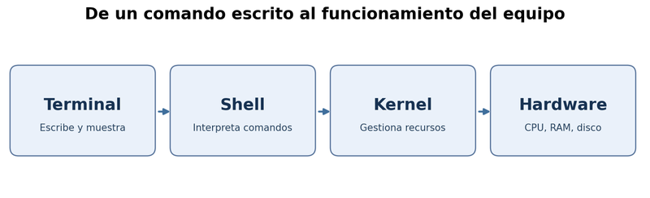
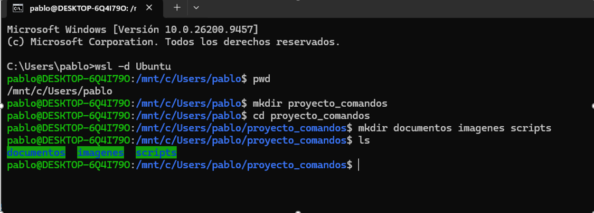
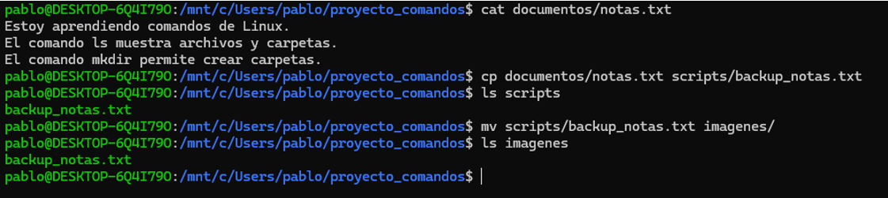
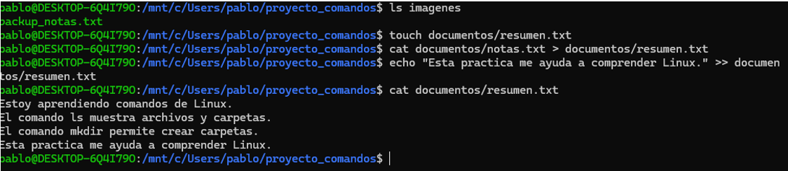
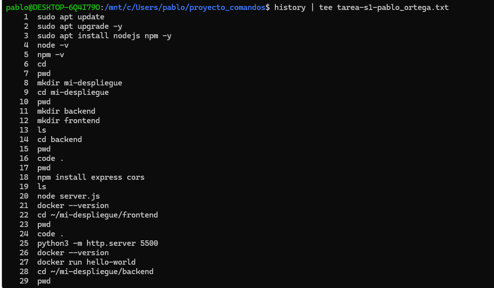
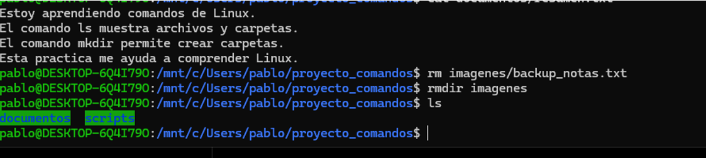

# Práctica No. 1: Creación y manipulación de archivos en Linux

**Asignatura:** Tendencias Tecnológicas  
**Estudiante:** Pablo Ortega  
**Semana:** 1  
**Entorno utilizado:** Ubuntu WSL 2 
**Fecha de realización:** 13 de octubre de 2026

## 1. Título

Creación, manipulación y eliminación de archivos y directorios mediante comandos de Linux.

## 2. Tiempo de duración

En esta practica tarde 30 minutos.

## 3. Fundamentos

La interfaz de línea de comandos, conocida como CLI (*Command Line Interface*), es una forma de interactuar con un sistema operativo escribiendo instrucciones en una terminal. A diferencia de una interfaz gráfica, que utiliza ventanas e íconos, la CLI permite realizar operaciones mediante comandos de texto. En Linux es especialmente importante porque ofrece un control preciso sobre archivos, directorios, programas y procesos. Además, permite repetir instrucciones y automatizar tareas que, de otra manera, requerirían muchos clics.

Cuando una persona introduce un comando, normalmente lo recibe un intérprete llamado *shell*. Bash es una de las shells más conocidas y se utiliza tanto en muchas distribuciones de Linux como en herramientas compatibles, por ejemplo Git Bash. La shell interpreta lo escrito por el usuario, ejecuta programas cuando corresponde y muestra los resultados. El kernel, por su parte, es el núcleo del sistema operativo: coordina el acceso al hardware y administra recursos como memoria, procesos y dispositivos de almacenamiento.

En esta práctica se emplean comandos básicos del sistema de archivos. El comando `pwd` indica el directorio actual y `ls` muestra su contenido. `mkdir` crea directorios, mientras que `cd` permite cambiar la ubicación de trabajo. Para crear un archivo vacío puede utilizarse `touch`; para consultar su contenido se usa `cat`. También se estudian `cp`, que copia archivos, y `mv`, que los mueve o cambia de nombre. La eliminación se realiza con `rm` para archivos y `rmdir` para directorios vacíos. Se debe tener precaución al borrar, ya que estos comandos no necesariamente envían el contenido a la papelera de reciclaje.

Otro concepto importante es la redirección de entrada y salida. El operador `>` envía la salida de un comando a un archivo y sobrescribe su contenido anterior, mientras que `>>` agrega información al final sin eliminar lo existente. Una tubería, representada con `|`, conecta la salida de un comando con la entrada de otro. Por ejemplo, `history | tee archivo.txt` permite mostrar el historial y guardarlo simultáneamente. Comprender estas herramientas ayuda a organizar información, generar respaldos y documentar las actividades realizadas en la terminal.

La utilidad de estos comandos va más allá de una práctica académica: constituyen la base para administrar servidores, manejar proyectos de desarrollo de software y trabajar de forma eficiente con sistemas Linux. Practicarlos facilita entender qué acciones se realizan, en qué carpeta se ejecutan y cómo verificar sus resultados antes de continuar.



*Figura 3-1. Esquema conceptual de interacción con el sistema mediante la terminal. Elaboración propia.*

## 4. Conocimientos previos

Para realizar la práctica es necesario conocer la función de una terminal, la diferencia entre archivo y directorio, las rutas relativas y el uso básico del teclado para introducir comandos. También se requiere comprender los operadores `>`, `>>` y `|`.

## 5. Objetivos a alcanzar

- Crear una estructura de carpetas desde la terminal.
- Crear archivos de texto y escribir información mediante redirección.
- Copiar, renombrar, mover y eliminar archivos.
- Redirigir y concatenar contenido sin perder información.
- Guardar un registro del historial de comandos y verificar el resultado de la práctica.

## 6. Equipo necesario

- Computadora con sistema operativo Windows o Linux.
- Git Bash o Ubuntu mediante WSL.
- Editor de texto compatible con Markdown.
- Cuenta de GitHub y acceso a Internet para publicar el informe.

## 7. Material de apoyo

- Material de la Semana 1 de la asignatura Tendencias Tecnológicas.
- Plantilla de informe del docente: https://github.com/maguaman2/informe-tendencias
- Manual de Bash: https://www.gnu.org/software/bash/manual/bash.html
- Manual de GNU Coreutils: https://www.gnu.org/software/coreutils/manual/coreutils.html

## 8. Procedimiento

**Paso 1.** Se creó el directorio principal y se ingresó en él.

```bash
mkdir proyecto_comandos
cd proyecto_comandos
pwd
```

**Paso 2.** Se crearon las tres subcarpetas solicitadas y se verificaron.

```bash
mkdir documentos imagenes scripts
ls
```



*Figura 8-1. Captura propia de la creación de las carpetas `documentos`, `imagenes` y `scripts`.*

**Paso 3.** Se creó `notas.txt` y se añadieron tres líneas.

```bash
touch documentos/notas.txt
echo "Estoy aprendiendo comandos de Linux." > documentos/notas.txt
echo "El comando ls muestra archivos y carpetas." >> documentos/notas.txt
echo "El comando mkdir permite crear carpetas." >> documentos/notas.txt
cat documentos/notas.txt
```

**Paso 4.** Se copió el archivo a `scripts` con otro nombre y se movió a `imagenes`.

```bash
cp documentos/notas.txt scripts/backup_notas.txt
ls scripts
mv scripts/backup_notas.txt imagenes/
ls imagenes
```



*Figura 8-2. Captura propia de la copia y el movimiento de `backup_notas.txt`.*

**Paso 5.** Se creó `resumen.txt`, se copió mediante redirección el contenido de `notas.txt` y se agregó una línea adicional.

```bash
touch documentos/resumen.txt
cat documentos/notas.txt > documentos/resumen.txt
echo "Esta practica me ayuda a comprender Linux." >> documentos/resumen.txt
cat documentos/resumen.txt
```



*Figura 8-3. Captura propia que demuestra las cuatro líneas de `resumen.txt`.*

**Paso 6.** Se eliminó el archivo de respaldo y después el directorio `imagenes`, que había quedado vacío.

```bash
rm imagenes/backup_notas.txt
rmdir imagenes
ls
```

**Paso 7.** Se guardó el historial de comandos con una tubería y `tee`.

```bash
history | tee tarea-s1-nombre_apellido.txt
```

**Nota:** En la ejecución real, se sustituyó `nombre_apellido` por el nombre y apellido del estudiante. Debe hacerse antes de ejecutar el comando.



*Figura 8-4. Captura propia del historial registrado y el archivo generado.*

## 9. Resultados esperados

La práctica debe terminar con dos carpetas: `documentos` (que contiene `notas.txt` y `resumen.txt`) y `scripts` (vacía). La carpeta `imagenes` ya no debe existir, porque fue eliminada después de borrar `backup_notas.txt`. También debe existir, en el directorio principal de trabajo, el archivo `tarea-s1-nombre_apellido.txt` con el nombre real del estudiante y el historial de la sesión.

El archivo `notas.txt` debe conservar tres líneas y `resumen.txt` debe contener esas mismas líneas más una adicional. Las capturas de pantalla permitirán comprobar que los comandos se ejecutaron correctamente.



*Figura 9-1. Captura real de la verificación final.*

**Verificación personal:** Durante esta práctica pude crear, copiar, mover y eliminar archivos utilizando comandos de Linux. Todos los comandos principales funcionaron correctamente. También aprendí a guardar el historial de la terminal y corregí un error al colocar el nombre del archivo.

## 10. Bibliografía

Free Software Foundation. (s. f.). *Bash reference manual*. GNU Project. https://www.gnu.org/software/bash/manual/bash.html

Free Software Foundation. (s. f.). *GNU coreutils manual*. GNU Project. https://www.gnu.org/software/coreutils/manual/coreutils.html

Maguaman, M. (s. f.). *Informe tendencias* [Plantilla de informe, repositorio de GitHub]. GitHub. https://github.com/maguaman2/informe-tendencias
